<h1 align="center">Hi 👋, I'm Md. Shams Imran</h1>
<h3 align="center">Lead DevOps Engineer · Fintech · Kubernetes · GitOps · DevSecOps</h3>
<p align="center">Dhaka, Bangladesh 🇧🇩</p>
<h4 align="center"><i>I break things on purpose so production doesn't break by accident.</i></h4>

<p align="center">
  <a href="https://shamsimran.iam.bd"></a>
  <a href="https://shamsimran.iam.bd/Resume_Of_Md_Shams_Imran.pdf"></a>
  <a href="https://www.linkedin.com/in/shams-imran"></a>
  <a href="mailto:imranmdshams@gmail.com"></a>
</p>

<p align="center">
  
  
</p>

---

### 🧑‍💻 About me

```yaml
whoami:
  role: Lead DevOps Engineer @Red Dot Digital IT Ltd.
  experience: 11+ years in software, 6+ focused on DevOps
  in_production: 120+ microservices across fintech, telecom, FMCG and government
  focus: [Kubernetes, GitOps, DevSecOps, Observability, Optimization, Legacy-to-K8s migrations]
  compliance: [CIS Benchmarks, PCI DSS]
  learning: [DevOps, System design, Platform engineering]
  ask_me_about: [Kubernetes, Docker, CI/CD, system design, optimization]
  fun_fact: Most innocent-looking person in the room right after production goes down
```

---

### 🏗️ What I've built and run

- 💳 **Fintech (MFS) platforms:** deployed and operate **TeleCash, LenDen and MyCash**, and ran **UPAY**'s 120+ microservice platform with PCI DSS compliance, SAST/DAST and image scanning in CI/CD
- 🔄 **Zero-data-loss migrations:** moved UPAY's entire platform to a new Kubernetes cluster, rebuilding Crunchy Postgres (PGO) and RookCeph storage; modernized a legacy IoT platform onto Kubernetes
- 🛡️ **Supply-chain security:** Trivy scanning, cosign image signing, SonarQube, Vault-backed secrets, network policies and mTLS
- 📈 **Observability:** ELK, Prometheus, Grafana and Fluent Bit stacks with real-time alerting to Slack
- 🏛️ **Nationally critical systems:** National Data Integration Platform for law enforcement, a secure calling and messaging platform for Bangladesh Police's Joint Command Center, and BEZA's One-Stop Service Center

👉 Full case studies on my [portfolio](https://shamsimran.iam.bd/projects).

---

### 🚀 Open-source projects

| Project | What it does |
|---|---|
| [**RBACGrant**](https://github.com/shams-imran/RBACGrant) | Web GUI for Kubernetes RBAC: build Roles and bindings from a form, catch risky permissions before you apply, and hand out short-lived kubeconfigs. *(Python)* |
| [**books**](https://github.com/shams-imran/books) ⭐ 696 | My curated engineering reading list: system design, SRE, Kubernetes, databases, algorithms, Java and TLS/cryptography. |

---

### 🛠️ Tech stack

**Containers & Orchestration**
<br/>


**CI/CD & Registries**
<br/>


**Infrastructure as Code**
<br/>


**Cloud Platforms**
<br/>


**Security (DevSecOps)**
<br/>


**Observability**
<br/>


**Networking & Gateways**
<br/>


**Data, Storage & Messaging**
<br/>


**Systems & Languages**
<br/>


---

### 📊 GitHub stats

<!-- These two cards are generated into this repo by .github/workflows/readme-stats.yml -->
<p align="center">
  
  
</p>

<p align="center">
  
</p>

<p align="center">
  <a href="https://shamsimran.iam.bd/contact"><b>Open to opportunities: let's build resilient systems together →</b></a>
  <br/><br/>
  
</p>
